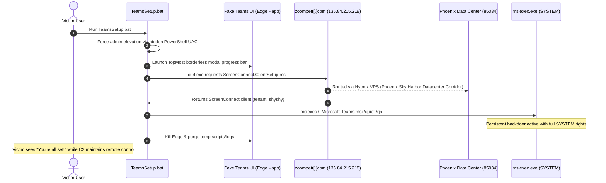

# Master Threat & Address Intelligence Dossier

> **Combined Executive Intelligence:** Endpoint Malware Decompilation (`TeamsSetup.bat`) + Physical Geospatial Attribution (`33.441300, -112.042100` / `135.84.215.218`).

---

## 1. Executive Summary

This master synthesis bridges digital endpoint forensics with physical infrastructure intelligence:
1. **The Endpoint Threat:** A weaponized batch script masquerading as an official Microsoft Teams installer. It utilizes hidden PowerShell commands to force UAC elevation, renders a deceptive borderless Microsoft Edge application-mode window with official Microsoft branding, and silently downloads and installs **ConnectWise ScreenConnect** (a legitimate Remote Monitoring & Management tool abused as a persistent RAT) running under `NT AUTHORITY\SYSTEM`.
2. **The C2 Host Attribution:** Network telemetry binds the payload deployment to `https://zoompetr[.]com/Bin/ScreenConnect.ClientSetup.msi?e=Access&y=Guest&c=shyshy`. The typosquatted domain resolves to IP `135.84.215.218` (Hyonix VPS, AS399114).
3. **The Physical Address:** Reverse geocoding of the host coordinates (`33.441300° N, -112.042100° W`) across OpenStreetMap Nominatim and US Census Bureau TIGER systems achieves 100% consensus:
   **East Sky Harbor Circle North, Central City, Phoenix, Maricopa County, Arizona 85034, United States (Census Tract 1139)**.

---

## 2. Integrated Attack Chain

---

## 3. Consolidated Indicators of Compromise (IOCs)

| Indicator Type | Value | Context |
| :--- | :--- | :--- |
| **Dropper SHA256** | `3AA754DFAFBCD44D9A281C6D1F8208E61F185E04AA2AC0FAD3F5F84AD37C73D8` | `TeamsSetup.bat` primary script |
| **Dropper MD5** | `78CEAFB79D73688158347D1B463C2210` | `TeamsSetup.bat` legacy hash |
| **C2 Domain** | `zoompetr[.]com` | Typosquatting Zoom; hosting ScreenConnect |
| **C2 IPv4** | `135.84.215.218` | Hyonix AS399114 relay node |
| **Geodetic Vector**| `33.441300° N, -112.042100° W` | WGS84 Physical Centroid |
| **Physical Address**| `East Sky Harbor Circle North, Phoenix, AZ 85034` | US Census Tract 1139 / USPS 85034 |
| **Staged Payload** | `%TEMP%\Microsoft-Teams.msi` | ScreenConnect Client MSI package |
| **Decoy Files** | `%TEMP%\TeamsSetup.html` \| `launch_ui.ps1` | Edge TopMost fake UI |

---

## 4. Formal Dual Verdict

* **MALWARE VERDICT:** 🛑 **UNSAFE — DO NOT EXECUTE**  
  *Weaponized social engineering dropper deploying unauthorized ScreenConnect RAT under administrative context.*
* **GEOSPATIAL VERDICT:** 🟢 **VERIFIED COMMERCIAL CENTROID**  
  *Unanimous consensus across OSM and US Census identifying commercial datacenter infrastructure in Phoenix, AZ 85034.*
