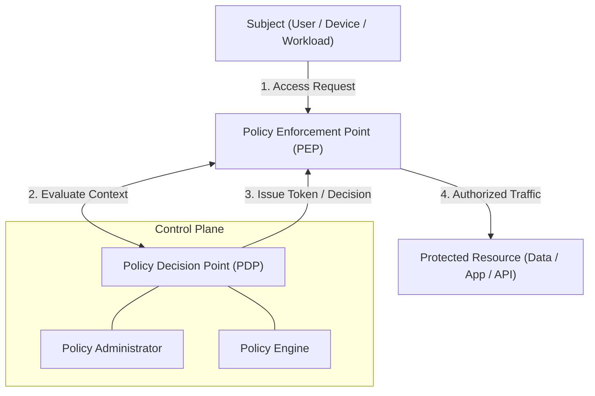

# Zero Trust Architecture (ZTA)

Zero Trust is a cybersecurity paradigm founded on the core axiom: **"Never Trust, Always Verify."** It eliminates implicit trust based on network locality (such as being inside a corporate VPN or local LAN) and requires every access request to be dynamically authenticated, authorized, and encrypted.

---

## 1. The Three Core NIST SP 800-207 Tenets

1. **Explicit Verification:** Always authenticate and authorize based on all available data points (user identity, location, device health, service or workload, data classification, and anomalies).
2. **Use Least Privilege Access:** Limit user access with Just-In-Time and Just-Enough-Access (JIT/JEA), risk-based adaptive policies, and data protection.
3. **Assume Breach:** Minimize blast radius and segment access. Verify end-to-end encryption and use telemetry to gain visibility, drive threat detection, and continuously improve defenses.

---

## 2. Logical Components

- **Policy Engine (PE):** Evaluates risk scores, credentials, and behavioral context against enterprise security rules.
- **Policy Administrator (PA):** Issues commands to establish or tear down communication paths.
- **Policy Enforcement Point (PEP):** Gatekeeper (e.g. reverse proxy, microsegmentation firewall, API gateway) that terminates the connection and enforces PDP decisions.

---

## 3. Practical Implementation Checklist

- [ ] Eliminate naked internal network access; route all application access through an identity-aware proxy (IAP).
- [ ] Enforce Phishing-Resistant MFA (FIDO2 / WebAuthn hardware keys).
- [ ] Implement Microsegmentation at the software layer (e.g., eBPF, Cilium, Illumio) preventing east-west lateral movement.
- [ ] Enforce device posture checks (compliance, EDR status, BitLocker encryption) before issuing session tokens.
