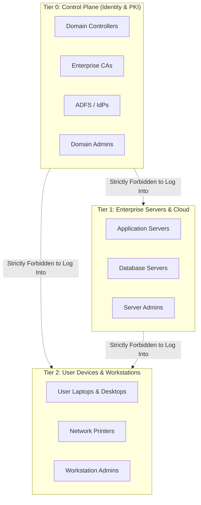

# Active Directory Hardening & Tiered Administration

Active Directory (AD) is the primary target for enterprise threat actors. Because AD relies heavily on legacy protocols and transitive trust relationships, hardening requires an architectural approach: limiting lateral movement and eliminating high-risk configurations.

---

## 1. Enterprise Administrative Tiering Model

### Golden Rules of Tiering
1. **No Downward Logons:** A Tier 0 credential (e.g. Domain Admin) must **NEVER** authenticate to or execute processes on a Tier 1 or Tier 2 machine. Doing so leaves credentials in LSASS memory vulnerable to dumping.
2. **Dedicated Privileged Access Workstations (PAWs):** Tier 0 administration can only occur from physically isolated, internet-disconnected PAWs.
3. **Local Administrator Password Solution (LAPS):** Ensures every workstation has a unique, automatically rotated local Administrator password stored securely in AD attributes.

---

## 2. Mitigation for Specific Kerberos & AD Attacks

### Mitigating Kerberoasting (`[[wiki/attacks/kerberoasting]]`)
- Deploy **Group Managed Service Accounts (gMSA)** for services.
- Mandate **25+ character complex passwords** for traditional service accounts.
- Enforce **AES encryption** (`msDS-SupportedEncryptionTypes` = 24 or 28) and disable RC4.

### Mitigating AS-REP Roasting
- Audit user accounts with "Do not require Kerberos preauthentication" (`DONT_REQ_PREAUTH`).
- Disable this setting on all accounts immediately.

### Mitigating Unconstrained Delegation
- Review accounts configured with `TRUSTED_FOR_DELEGATION`.
- Restrict delegation to **Kerberos Constrained Delegation (KCD)** with Protocol Transition or Resource-Based Constrained Delegation (RBCD).

---

## 3. Telemetry & Auditing Configuration

| Event ID | Channel | Description | Threat Detected |
| :--- | :--- | :--- | :--- |
| **4768** | Security | Kerberos TGT requested | AS-REP Roasting / Brute Force |
| **4769** | Security | Kerberos TGS requested | `[[wiki/attacks/kerberoasting]]` |
| **4624** | Security | Successful Logon (Check LogonType 3 vs 10) | Lateral Movement / Pass-the-Hash |
| **4672** | Security | Special privileges assigned to new logon | Privilege Escalation / Admin logon |
| **5136** | Security | Directory service object modified | Shadow Admin ACL backdoor |
