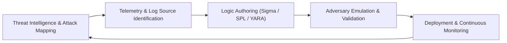

# Detection Engineering & Telemetry Lifecycle

Detection Engineering is the practice of designing, testing, deploying, and tuning detection logic to identify adversary behaviors before significant damage occurs.

---

## 1. The Detection Engineering Lifecycle



1. **Threat Research:** Map target adversary techniques using `[[wiki/frameworks/mitre-attack]]`.
2. **Telemetry Gap Analysis:** Verify whether endpoints and network collectors capture necessary event types (e.g., Sysmon Process Creation with Command Line arguments - Event ID 1).
3. **Rule Authoring:** Use standard, vendor-agnostic formats like **Sigma** so rules can be compiled into Splunk, Microsoft Sentinel, Elastic, or CrowdStrike LogScale.
4. **Adversary Emulation:** Execute atomic tests (using Atomic Red Team) to confirm alerts trigger without blind spots.
5. **False Positive Tuning:** Filter legitimate administrative behavior without blinding the rule.

---

## 2. Telemetry Pyramid

| Layer | Key Technologies | High-Value Telemetry Points |
| :--- | :--- | :--- |
| **Endpoint (Host)** | EDR, Sysmon, Auditd, OSQuery | Process creation (parent-child), memory injection, DLL loading, file writes |
| **Identity & Auth** | Kerberos, Active Directory, Okta, Entra ID | Ticket requests (Event 4769), MFA changes, privilege assignment (Event 4672) |
| **Network** | Zeek, Suricata, Firewall, NetFlow | DNS tunneling, beaconing jitter, SMB named pipe traffic, unencrypted LDAP |
| **Cloud** | CloudTrail, Azure Activity, VPC Flow Logs | IAM policy modifications, AssumeRole calls, anomalous region API calls |

---

## 3. Sample Sigma Rule: Kerberoasting Detection

```yaml
title: Potential Kerberoasting Ticket Request
id: 3fa4a9e2-28df-4613-8b77-cfb89088be33
status: experimental
description: Detects abnormal volume of Kerberos TGS service requests with RC4 encryption (0x17)
references:
    - https://attack.mitre.org/techniques/T1558/003/
tags:
    - attack.credential_access
    - attack.t1558.003
logsource:
    product: windows
    service: security
detection:
    selection:
        EventID: 4769
        TicketOptions: '0x40810000'
        TicketEncryptionType: '0x17'
    condition: selection | count() by IpAddress > 5
timeframe: 1m
falsepositives:
    - Legacy applications not supporting AES encryption
level: high
```
