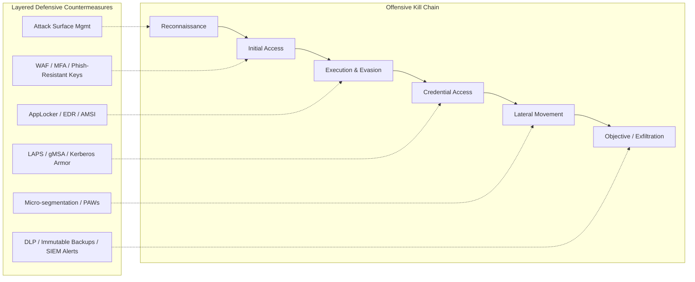

# Cybersecurity Master Overview & Strategic Doctrine

## 1. The Operational Philosophy

Cybersecurity is defined by fundamental operational asymmetry:
> *The attacker only needs to discover a single unpatched flaw, misconfigured permission, or leaked token to achieve a foothold; the defender must secure every asset, credential, and communication channel 100% of the time.*

To overcome this asymmetry, modern defensive doctrine abandons perimeter-only security in favor of **Assume Breach** and **[[wiki/architectures/zero-trust-architecture|Zero Trust Architecture]]**. When an initial foothold is assumed to be inevitable, the defender's focus pivots to:
1. **Minimizing Blast Radius:** Strict segmentation, least privilege, ephemeral credentials.
2. **Maximizing Attacker Friction:** Active Directory tiering, disabling legacy protocols (NTLM, RC4), honeypots, canary tokens.
3. **High-Fidelity Telemetry:** Instrumentation at the host (EDR/Sysmon), identity provider (Entra ID, Kerberos), and network (Zeek, NetFlow) layers.
4. **Fast Detection & Automated Response:** Proactive detection engineering using Sigma, YARA, and automated containment.

---

## 2. The Unified Lifecycle: Kill Chain vs. Defensive Layers

Every offensive technique documented in this vault maps directly across this spectrum:
- **Offensive Technique:** [[wiki/attacks/kerberoasting|Kerberoasting]] → Explores service ticket requests to crack offline passwords.
- **Defensive Countermeasure:** [[wiki/defenses/active-directory-hardening|Active Directory Hardening]] → Enforce AES encryption, use Group Managed Service Accounts (gMSA), set 25+ character passwords, and monitor Event ID 4769.
- **Investigation Tool:** [[wiki/tools/bloodhound|BloodHound]] → Enumerates hidden ACL relationships and attack paths before adversaries exploit them.

---

## 3. Core Knowledge Pillars in this Vault

| Pillar | Focus | Key Nodes |
| :--- | :--- | :--- |
| **Identity & AD** | Kerberos, NTLM, LDAP, Entra ID, GPO, Trust relationships | [[wiki/attacks/kerberoasting]], [[wiki/tools/bloodhound]], [[wiki/defenses/active-directory-hardening]] |
| **Application Security** | OWASP Top 10, API security, SSRF, SQLi, deserialization | [[wiki/frameworks/owasp-top-10]], [[wiki/attacks/sql-injection]], [[wiki/analyses/threat-model-web-auth]] |
| **Auditing & Forensics** | Universal file inspection, SAST, secrets, Big Four PDF reports | [[wiki/defenses/vulnerability-auditing-methodology]], [[wiki/defenses/automated-security-reporting]], [[wiki/tools/security-scanners-suite]] |
| **Vulnerability Research** | Memory safety, logic flaws, zero-days, CVE root causes | [[wiki/vulnerabilities/log4shell-cve-2021-44228]] |
| **Detection Engineering** | Telemetry ingestion, Sigma rules, SIEM correlation, hunting | [[wiki/defenses/detection-engineering]] |
| **Recon & Tooling** | Network scanning, enumeration, binary analysis, traffic inspection | [[wiki/tools/nmap]], [[wiki/tools/bloodhound]], [[wiki/tools/security-scanners-suite]] |
| **Enterprise Architecture** | Zero Trust, microsegmentation, cloud security (AWS/Azure) | [[wiki/architectures/zero-trust-architecture]] |

---

## 4. How this Wiki Compounds Over Time

1. **Ingest Phase:** When reading writeups or alerts, do not store static notes. Break the source down:
   - What was the initial bug? → Add/update `wiki/vulnerabilities/` or `wiki/attacks/`.
   - What tool was used? → Add flags and detection to `wiki/tools/`.
   - What logged it? → Add detection rules to `wiki/defenses/`.
2. **Reviewing the Graph:** In Obsidian, open Graph View (`Ctrl + G`). Dense clusters reveal your mastery hubs; isolated orphan nodes highlight areas requiring further reading or lab drills.
3. **Evolving this Document:** As you conquer advanced topics (e.g., kernel exploitation, cloud identity federation, supply-chain risks), update this overview to reflect your growing technical synthesis.
