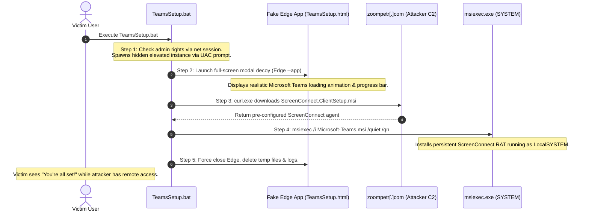

# Malware Analysis: Fake Teams Installer Dropping ScreenConnect RAT

## 1. Executive Assessment
- **Sample Name:** `TeamsSetup.bat`
- **File Type:** Windows Batch Script (.bat)
- **SHA256:** `3AA754DFAFBCD44D9A281C6D1F8208E61F185E04AA2AC0FAD3F5F84AD37C73D8`
- **MD5:** `78CEAFB79D73688158347D1B463C2210`
- **Verdict:** <font color="#DC2626">**CRITICAL MALWARE / UNSAFE — DO NOT EXECUTE**</font>

---

## 2. Attack Chain & Decompilation



---

## 3. Indicators of Compromise (IOCs)

| Type | Indicator | Context |
| :--- | :--- | :--- |
| **Domain** | `zoompetr[.]com` | Attacker C2 / ScreenConnect relay (Spoofing Zoom) |
| **IP Address** | `135.84.215.218` | C2 Host IP |
| **Download URL** | `https://zoompetr[.]com/Bin/ScreenConnect.ClientSetup.msi?e=Access&y=Guest&c=shyshy` | ConnectWise ScreenConnect unattended client download |
| **File Path** | `%TEMP%\Microsoft-Teams.msi` | Dropped installer |
| **File Path** | `%TEMP%\TeamsSetup.html` | Decoy phishing interface |
| **File Path** | `%TEMP%\launch_ui.ps1` | UI launcher script |

---

## 4. Detection Engineering & Sigma Rule

```yaml
title: Suspicious ScreenConnect MSI Download via Batch Dropper
id: b49c581a-4d22-4a0b-9304-4363297a7e11
status: production
description: Detects curl or msiexec downloading and executing ScreenConnect client setup from unapproved domains
logsource:
    category: process_creation
    product: windows
detection:
    selection_curl:
        Image|endswith: '\curl.exe'
        CommandLine|contains:
            - 'ScreenConnect.ClientSetup.msi'
            - 'zoompetr'
    selection_msiexec:
        Image|endswith: '\msiexec.exe'
        CommandLine|contains:
            - '/quiet'
            - '/qn'
            - 'Microsoft-Teams.msi'
    condition: selection_curl or selection_msiexec
level: critical
tags:
    - attack.execution
    - attack.t1219
    - attack.t1105
```
